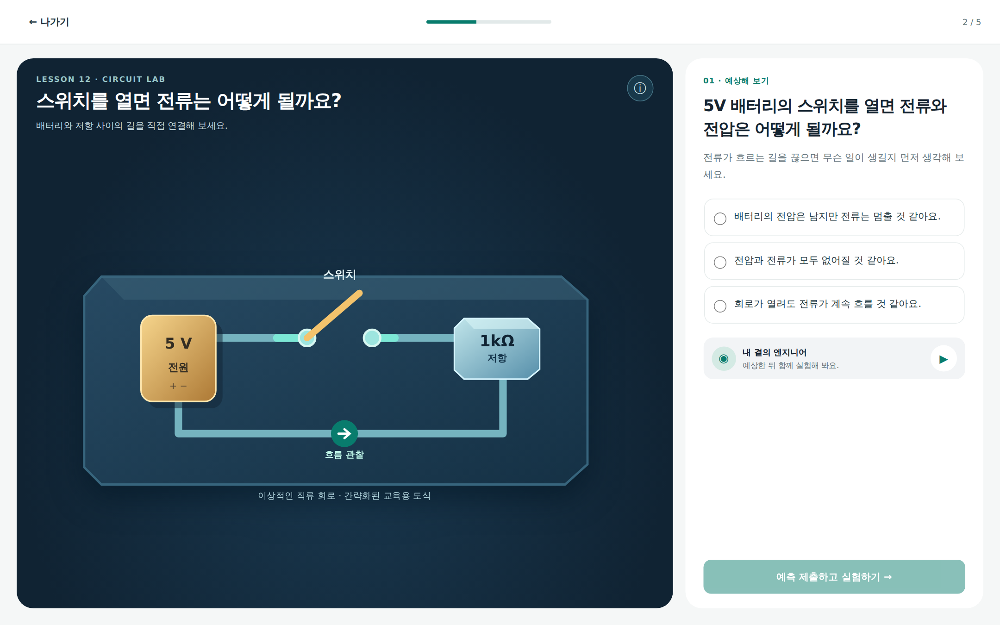
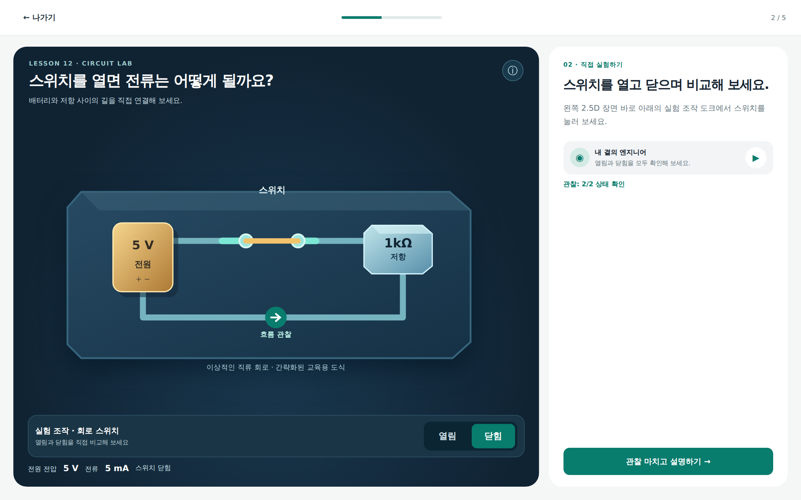
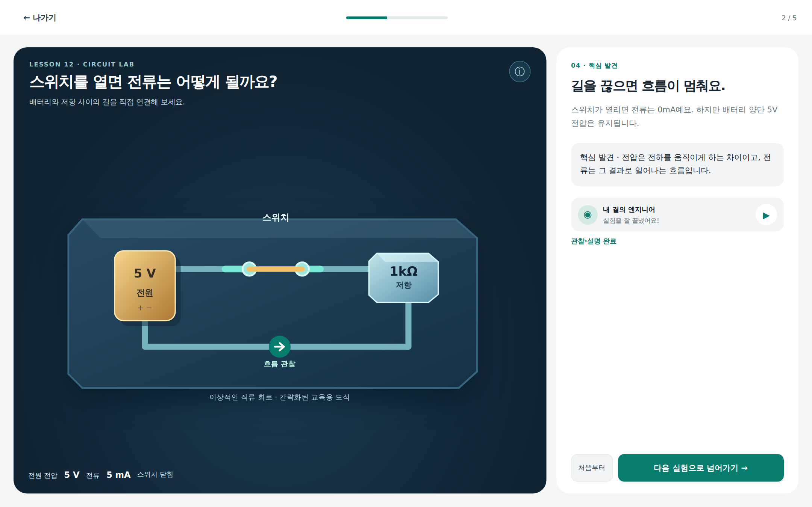
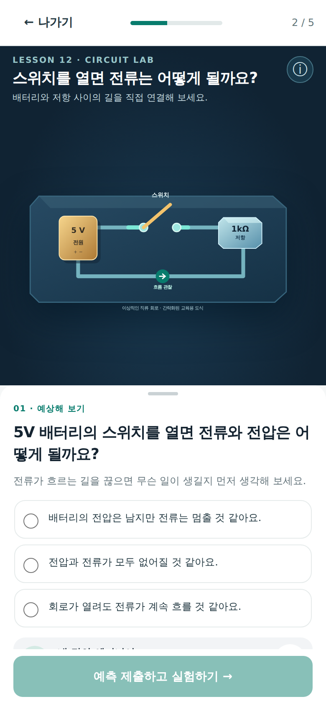
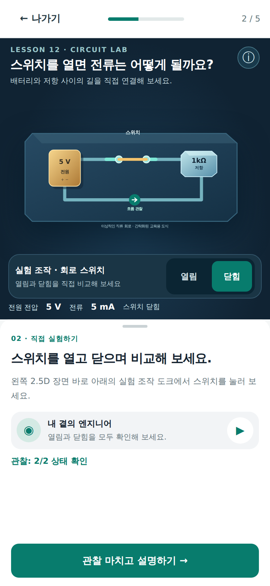
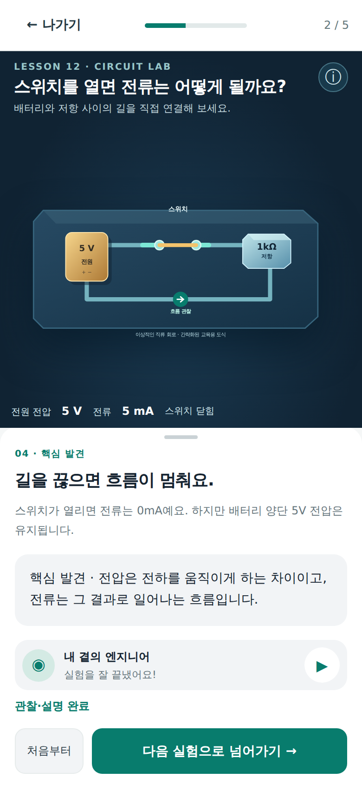
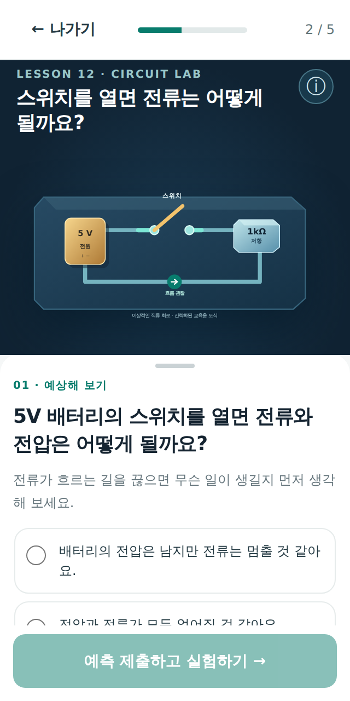
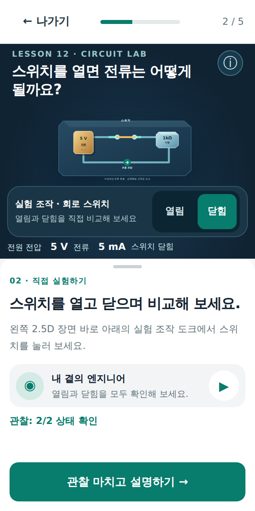
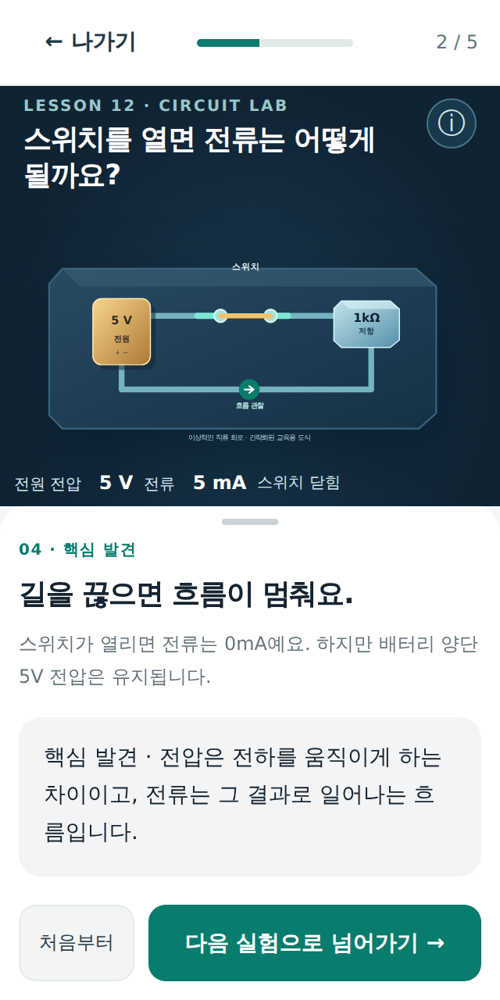

# A03 · Lesson 12 회로 스위치 UX — 최신 디자인 갤러리

> **상태: A03 실행 가능한 시각/학습 UX 레퍼런스 (React 제품 앱 아님)**. 이미지/HTML은 A03의 인터페이스 권한을 기준으로 제작했으며 5V/1kΩ 회로의 관찰 상태는 교육용 단순 모델입니다. A05 과학 씬과 A02 학습 엔진은 각 담당자가 실제 통합합니다.

**[직접 실행 가능한 현재 HTML UI](prototypes/a03-lesson12-switch-layout-reference.html)** · **[9개 PNG 생성 스크립트](prototypes/capture-lesson12-reference.mjs)** · **[A02/A05의 P0 구현 및 과학/접근성 조건](UI-AUTHORITY-LESSON12-P0.md)** · **[현재 디자인만 보기](CURRENT.md)**.

## 1. 데스크톱 1440×900
| 예측 — Problem 한 문제 | 실험 — 스위치가 2.5D 도크에 있음 | 완료 — 1개 다음 CTA |
|:--:|:--:|:--:|
|  |  |  |

## 2. 모바일 390×844
| 예측 | 실험 | 완료 |
|:--:|:--:|:--:|
|  |  |  |

## 3. 모바일 320×640
| 예측 | 실험 | 완료 |
|:--:|:--:|:--:|
|  |  |  |

## 핵심 차이 (기존 실앱 → A03 시안)

1. **회로 스위치가 Problem 질문 패널에 있던 구조를 제거**하고 2.5D 실험실 하단 도크로 이동.
2. 예측을 제출하기 전에는 전류·전압 결과 Readout과 스위치 도크가 보이지 않습니다.
3. 사용자가 OPEN/CLOSED를 직접 조작한 이후에만 관찰 결과를 표시하며, Lesson12에서 MOSFET VGS/VDS·문턱 전압이 나타나지 않습니다.
4. MOSFET V2와 **같은 외부 light shell / dark navy 2.5D lab / teal CTA / white panel** 디자인 체계를 따릅니다. 전기회로 소자는 5V 전원과 저항/스위치라는 별개 물리 모델이므로 MOSFET 게이트 모양을 복사하지 않습니다.
5. **A02가 공식 React 앱을 고친 후** 같은 뷰포트의 실제 앱 캡처를 따로 만들고 이 A03 이미지 옆에서 검수해야 완료입니다.

**검증 게이트**: [Lesson 12 / UI 차단 이슈 #65](https://github.com/Junebooky/interactive-engineering/issues/65) · [원본 교육 레슨 #27](https://github.com/Junebooky/interactive-engineering/issues/27) · [팀 현황판 #21](https://github.com/Junebooky/interactive-engineering/issues/21). 이미지 캡처 CI는 성공 여부를 확인하고 기록해야 하며 그 전에는 이미지 제작 PASS를 표시하지 않습니다.
