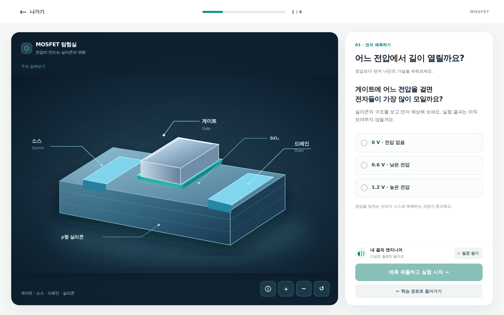
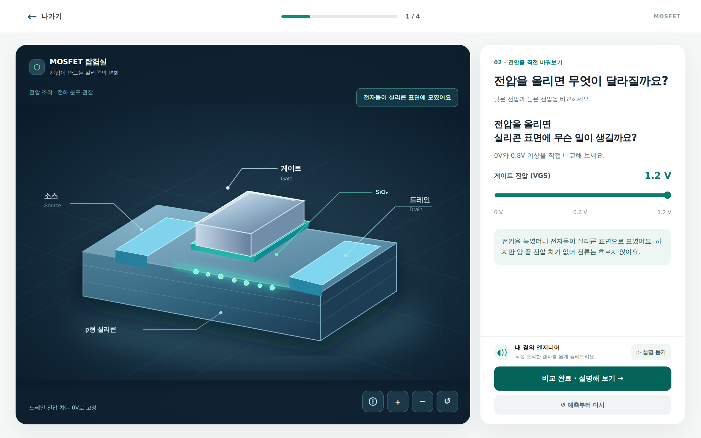
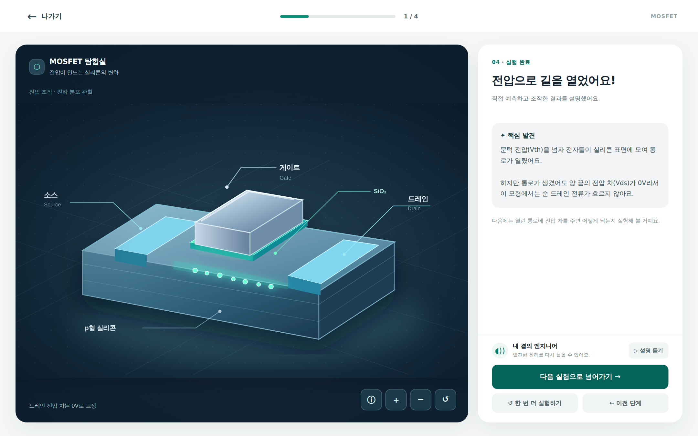
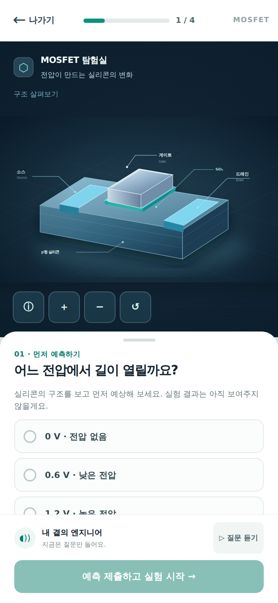
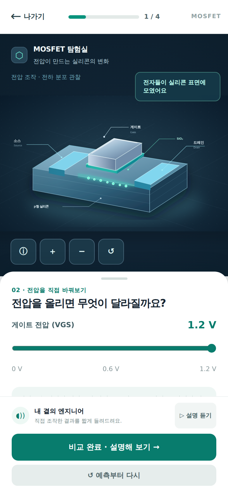
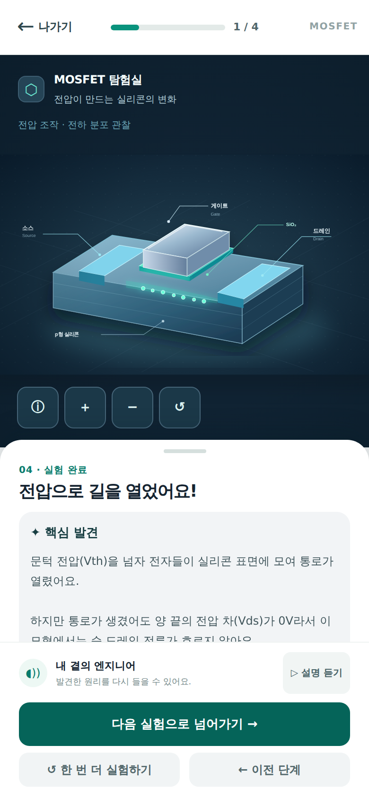
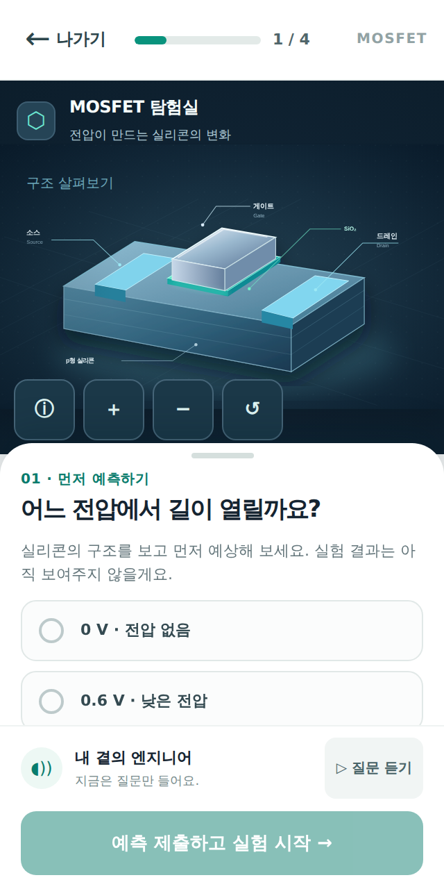
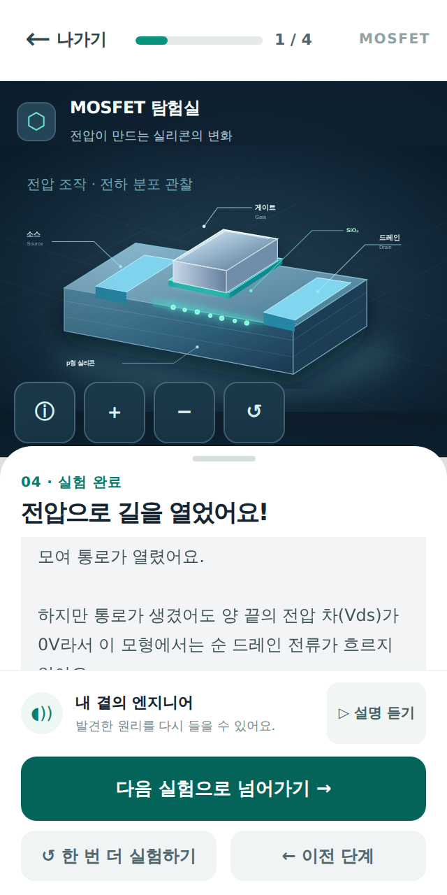

# A03 MOSFET V2 — GitHub 스크린샷 갤러리

> **정체: A03 별도 HTML/SVG 디자인 프로토타입을 Chromium에서 캡처한 레퍼런스 이미지. 실제 A02 React 앱 실행 화면이 아닙니다.** 구현 완료/앱 E2E/과학 QA를 뜻하지 않습니다.

**실행 가능한 원본:** [a03-mosfet-discovery-v2.html](prototypes/a03-mosfet-discovery-v2.html) · **이미지 자동 재생성:** [capture-reference.mjs](prototypes/capture-reference.mjs) · **A02 구현/검증 계약:** [A02 implementation contract](A02-implementation-contract-mosfet-v2.md)

## 데스크톱 1440×900

| 예측 전 | 관찰 | 완료 |
|:--:|:--:|:--:|
|  |  |  |

## 모바일 390×844

| 예측 전 | 관찰 | 완료 |
|:--:|:--:|:--:|
|  |  |  |

## 모바일 320×640

| 예측 전 | 완료 |
|:--:|:--:|
|  |  |

**브라우저 캡처 조건:** desktop DPR 1.5, mobile DPR 2, reduced-motion; 같은 원본 HTML을 Playwright로 재실행. 여기서 표기한 `observe`는 디자인 toy 단계이며 실제 A05 SceneVisual/교육 채점 결과가 아닙니다.

## 개발팀 활용법
A02는 먼저 위 갤러리를 보고, 그다음 HTML의 CSS와 인터랙션 상태를 확인하세요. 실제 제품 코드에서 A05 과학 모델을 재사용하고, **동일 viewport의 공식 React 앱 화면**을 새롭게 캡처해 이 갤러리와 옆에 놓고 비교하세요. 정답 선노출, 바텀시트 스크롤/CTA, 폰트, 인과관계와 음성·ARIA 상태는 픽셀 유사성보다 우선합니다.

- **A03 디자인/이미지 브랜치**: [Draft PR #55](https://github.com/Junebooky/interactive-engineering/pull/55)
- **A02 제품 구현 이슈**: [#58](https://github.com/Junebooky/interactive-engineering/issues/58)
- **과학 표현 검토**: A05/A07 담당 (아직 별도 검증)
- **승인 게이트**: main 병합/배포는 오너 별도 승인까지 HOLD

**참고:** 첫 캡처 Artifact는 14일 보관이며, 이 폴더에 커밋된 PNG는 GitHub 디자인 브랜치에 영구 보존됩니다. 디자인 브랜치가 삭제/병합될 경우 일반 Git 보존 정책을 따릅니다.
