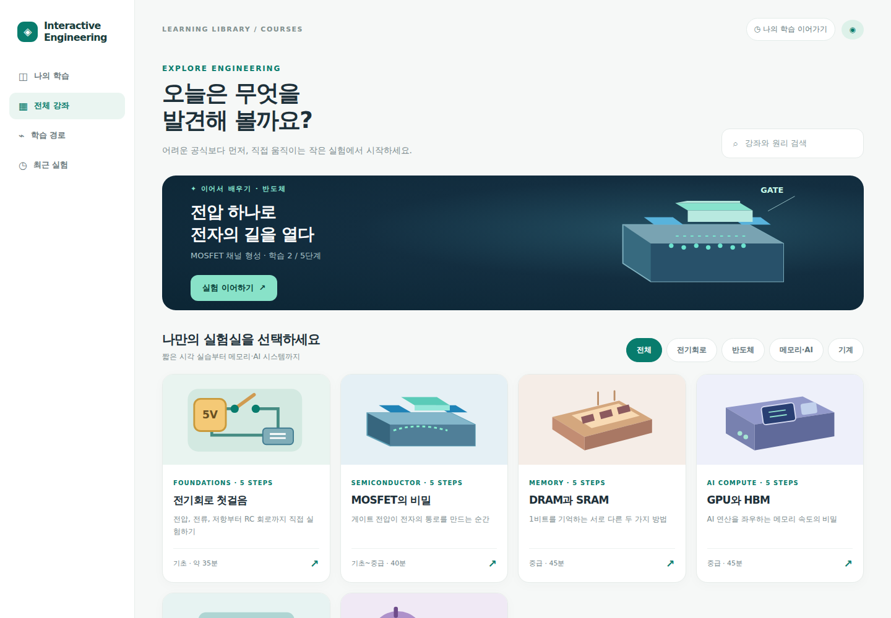
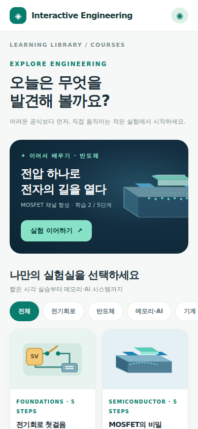
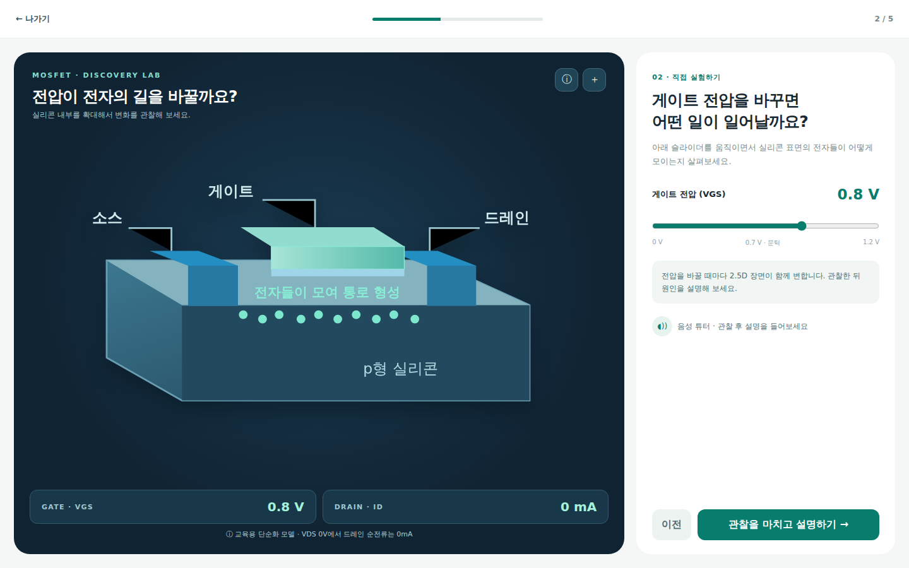
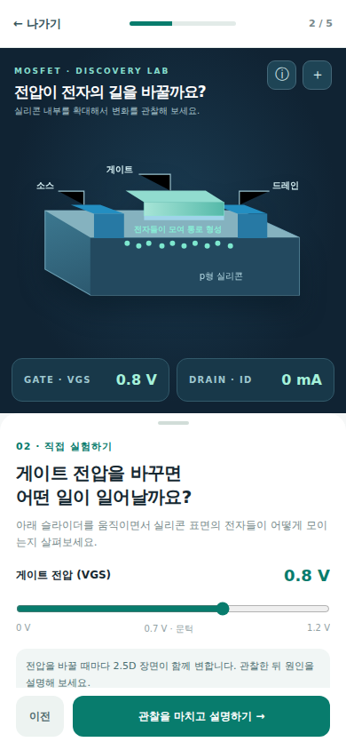
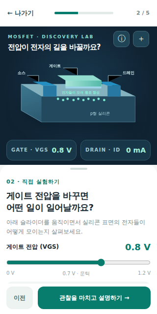

# A03 V3 — 최신 제품 디자인 갤러리

> **디자인 콘셉트 렌더, 실제 공식 A02 앱 캡처 아님.** 원본 HTML/CSS/SVG가 Chromium에서 렌더링된 이미지입니다. 검증 실행: [GitHub Actions #39127237173](https://github.com/Junebooky/interactive-engineering/actions/runs/39127237173) SUCCESS.
>
> 공식 A02 React 구현은 [Draft PR #73](https://github.com/Junebooky/interactive-engineering/pull/73)에서 별도 검수 중입니다. [A03 실앱 디자인 검수 보고서](A03-PR73-V3-app-visual-review.md)의 P0 문제 때문에 **UI_DESIGN_PASS 아님**.

## 강좌 카탈로그
| Desktop 1440×1000 | Mobile 390×844 |
|:--:|:--:|
|  |  |

## MOSFET 학습 화면
| Desktop 1440×900 | Mobile 390×844 | Small Mobile 320×640 |
|:--:|:--:|:--:|
|  |  |  |

## A02/A05/A08 구현 기준
- 원본 소스: [V3 카탈로그 HTML](prototypes/a03-v3-catalog.html) · [V3 MOSFET HTML](prototypes/a03-v3-mosfet-lesson.html).
- 동일 렌더 재현: [Playwright 캡처 스크립트](prototypes/capture-v3-reference.mjs). 소스·폰트/DPR·viewport 차이로 픽셀은 조금 다를 수 있으므로 의미/상호작용과 정보 위계의 일치를 최우선으로 합니다.
- 구현 계약: [V3 mobile/catalog/visual coverage](A03-V3-mobile-catalog-visual-coverage-contract.md).
- 디자인 승인 게이트: [A02 PR #73 시각 비교 및 P0 문제](A03-PR73-V3-app-visual-review.md).
- 전기회로 Lesson12 별도 현재 시안: [Lesson12 9장 갤러리](GALLERY-lesson12.md).
- 최신 문서 단일 진입점: [CURRENT.md](CURRENT.md).
- main 병합/배포 금지, A02 공식 앱/과학/Voice/스크린리더는 별도 검수.

**아카이브 정책**: V2는 대체되어 현재 작업 폴더에서 삭제되었으며 과거 모습은 Git 커밋 및 기존 PR history로 추적합니다. 최신 시안이 바뀌면 이 갤러리/HTML/이미지/상태 명세를 함께 갱신합니다.
