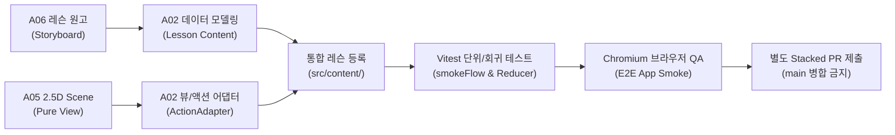

# A02 학습 엔진 공통 콘텐츠 계약 (Content Pipeline Contract v0.3)

- **작성일**: 2026-10-17
- **기준 브랜치/HEAD**:
  - A02 학습 엔진: `feat/d02-a05-a06-integration` (PR #11)
  - A05 2.5D 그래픽: `feat/a05-dram-1t1c-scenes` (PR #10 HEAD `00eb302`), `feat/a05-mosfet-discovery-scenes` (PR #8 HEAD `374a72d`)
  - A06 교육 커리큘럼: `content/a06-curriculum` (PR #7 HEAD `b8692e8`)
  - A07 교육 QA 검토: `docs/a07-edu-qa-round-01` (PR #14 / Issue #12)
- **목적**: A06의 확정 10개 레슨 / 41개 Step 및 향후 확장형 학습 Atlas(14개 레슨 / 57개 Step 이상) 교육 설계를 A02 실제 학습 엔진(`src/engine/LearningContext.tsx`, `LessonPlayer.tsx`)에 점진적·안정적으로 수용하기 위한 공통 데이터 스키마, 도메인 액션 어댑터 및 등록 파이프라인 규격 정의.

---

## 1. 아키텍처 및 역할 분담 (SSOT 원칙)

1. **A02 학습 엔진 (공식 상태 단독 소유)**:
   - FSM 라이프사이클(`READY` $\to$ `INTERACTING` $\to$ `EVALUATING` $\to$ `EVALUATED_CORRECT` / `EVALUATED_INCORRECT` $\to$ `LESSON_FINISHED`) 단독 관리.
   - 예측 가림(Veiled) 해제, 파라미터 조작 이력(`visited`), 조건별 복합 판정(`RuleEvaluationResult[]`), 3단계 점진적 스캐폴딩 힌트, 심층 Why 모달, 음성 튜터(Web Speech), 로컬스토리지 진척도 저장·복원을 100% 소유.
   - **도메인 전용 액션/물리 상태 어댑터 (Typed Action Adapter)**:
     - 단순 UI 토글/슬라이더 클릭이 곧바로 정답 이력으로 인정되는 조작 흉내를 방지하고, 물리적 인과관계(`writeCell`, `senseRead`, `leakageVoltage`)를 만족할 때만 물리 상태(`cell`, `phase`, `refreshAt`)와 이력(`history: string[]`)을 원자적으로 갱신합니다.
     - 메인 리듀서(`learningReducer.ts`) 내에서 `UPDATE_PARAM` 디스패치 시 도메인 어댑터(`src/engine/adapters/dramActionAdapter.ts` 등)를 호출하여 상태를 단일 진실 원천(SSOT)으로 보존합니다.
     - A05 Standalone Lab 등의 내부 로컬 상태를 메인 엔진에 중복 삽입하지 않으며, 순수 뷰(Pure View) 컴포넌트만을 어댑팅합니다.
2. **A05 2.5D 인터랙티브 씬 (순수 뷰 및 물리 계산)**:
   - `SceneVisual({ sceneId, values, showObservation })` 형태의 순수 SVG/2.5D 컴포넌트 제공.
   - `scenePhysics.ts` 및 `dramModel.ts` 등 확정된 결정론적 수치 모델 소유.
3. **A06 교육 콘텐츠 (스토리텔링 및 학습 설계)**:
   - 10개 레슨 41 Step 시나리오, 예측 문항, 오개념 피드백, 3단계 힌트, 음성 튜터 스크립트, 교육용 모델 가정(toy assumption) 및 출처 명세 소유.
4. **A07 교육 및 사실 정확성 교차 검증 (Pedagogical QA)**:
   - 학생 인지 부하, 예측 문항의 스포일러 방지(중립성 유지), 정규화 단위 표기($V_{DD}$ 배수, toy 시간 vs 표준 규격), 오개념 진단 피드백 검증.

---

## 2. 공통 최소 데이터 스키마 (`src/types/index.ts` 기준)

### 2.1 Lesson & Step 최소 스키마
```typescript
export interface Lesson {
  id: string; // 고유 ID (예: 'lesson-mosfet', 'lesson-dram')
  courseId: string; // 소속 강좌 (예: 'course-semiconductor')
  slug: string;
  title: string;
  subtitle: string;
  description: string;
  category: 'semiconductor' | 'circuits' | 'mechanics' | 'systems';
  prerequisites?: string[]; // 선수 레슨 ID 목록
  steps: LessonStep[];
}

export interface LessonStep {
  id: string; // 스텝 고유 ID (예: 'step-mosfet-s1-channel', 'step-dram-s1-write')
  title: string;
  stepType: 'CONCEPT' | 'MANIPULATE' | 'CHECK';
  storyLead: string; // 도입 스토리텔링 (1~2문장)
  prompt: string; // 사용자 수행 지시문 (displayText)
  detailExplanation?: string; // 아코디언 이론 심층 해설
  whyExplanation?: string; // 성공 후 Why 팝업 해설 (nextHook 포함)
  simulatorType?: SimulatorType; // 연동할 2.5D 시뮬레이터 씬 ID
  initialParams?: Record<string, any>; // 초기 파라미터 상태
  controls?: StepControl[]; // 인터랙티브 컨트롤 목록
  rules?: ValidationRule[]; // 검증 규칙 목록
  successMessage?: string; // 통과 축하 메시지
  successVoice?: string; // 통과 음성 대사
  voice?: StepVoiceScript; // 튜터 음성 스크립트 (intro, milestone, explanation)
  hints?: StepHint[]; // 3단계 점진적 스캐폴딩 힌트
  physicsAssumptions?: string; // 교육용 모델 가정 (toy model)
  sourceRefs?: string[]; // 교재 및 논문 출처
}
```

### 2.2 StepControl 컨트롤 스키마
```typescript
export interface StepControl {
  id: string; // 파라미터 키 (예: 'vgs', 'vin', 'wl', 'bl', 'prediction', 'answer')
  label: string;
  type: 'slider' | 'discreteSlider' | 'toggle' | 'truthTable' | 'gearSelector' | 'radioGroup';
  unit?: string;
  min?: number;
  max?: number;
  step?: number;
  options?: Array<{
    label: string;
    value: any; // 도메인 값 (number, boolean, string)
    description?: string;
    misconception?: string; // 오답 선택 시 오개념 피드백
  }>;
}
```

### 2.3 ValidationRule 검증 규칙 스키마
```typescript
export interface ValidationRule {
  targetKey: string; // 검증 대상 파라미터
  label?: string; // UI에 표시될 조건 라벨 (예: 'WL ON에서 비트 1 쓰기')
  operator: 'eq' | 'gte' | 'lte' | 'between' | 'near' | 'visitedLowHigh' | 'contains';
  expected: number | boolean | string | [number, number];
  tolerance?: number; // for 'near'
  feedbackIfFail: string; // 실패 시 개별 피드백
  voiceIfFail?: string; // 실패 시 음성 안내
}
```

---

## 3. A06 원고 필드 $\to$ A02 엔진 필드 1:1 매핑 표

| A06 원고 필드 | A02 학습 엔진 필드 | 설명 및 런타임 처리 방식 |
|---|---|---|
| `learningGoal` / `priorKnowledge` | `Lesson.description` / `prerequisites` | 강좌 카탈로그 및 레슨 헤더에 노출 |
| `storyHook` | `LessonStep.storyLead` | 스텝 상단 스토리텔링 리드문 |
| `question` / `displayText` | `LessonStep.prompt` | 메인 사용자 행동 지시문 |
| `prediction` | `controls`의 `radioGroup` (`id: 'prediction'`) | 선택 전 관찰 영역 가림(`.a05-veiled`), 선택 즉시 씬 노출 |
| `learnerAction` / `modelInputs` | `controls` (`slider`, `toggle` 등) | 도메인 값(0/5V, true/false)을 매핑하여 엔진 상태 갱신 |
| `expectedObservation` | A05/D02 Scene 렌더링 (`showObservation: true`) | 조작에 따른 물리 모델 반응 시각화 |
| `correctIncorrectCriteria` | `LessonStep.rules[]` | `evaluateStepRules`에서 실시간 개별 ✓/✗ 평가 |
| `misconceptions` | `options[].misconception` / `rules[].feedbackIfFail` | 오답 선택 시 즉시 하단 피드백 영역에 표시 |
| `hints` | `LessonStep.hints[1..3]` | 1단계(방향) $\to$ 2단계(단서) $\to$ 3단계(거의 정답) 스캐폴딩 |
| `explanation` | `LessonStep.detailExplanation` | 아코디언 토글 형태의 심층 이론 해설 |
| `whyExplanation` | `LessonStep.whyExplanation` | 정답 완료 후 활성화되는 "Why? 원리" 팝업 모달 |
| `nextHook` | `LessonStep.whyExplanation` 말미 | 다음 스텝 또는 다음 레슨(예: DRAM, SRAM)으로의 자연스러운 연결 |
| `speechText` | `LessonStep.voice` (`intro`, `milestone`, `explanation`) | Web Speech API 또는 텍스트 대체 fallback으로 전달 |
| `physicsAssumptions` | `LessonStep.physicsAssumptions` | toy 모델의 단순화 가정(온저항, 시비율 등) 명시 |
| `sourceRefs` | `LessonStep.sourceRefs` | 참고 문헌 및 반도체 물리학 교재 인용 |
| `sceneId` | `LessonStep.simulatorType` | `SimulatorType` 레지스트리에 매핑 |

---

## 4. 커리큘럼 기준선과 지속 확장형 학습 Atlas (Expansion Roadmap)

A02 학습 엔진은 단일 하드코딩 구조를 지양하고, **확정된 커리큘럼 기준선**과 **향후 확장형 Atlas 로드맵**을 명확히 구분하여 점진적으로 통합합니다:

### 4.1 확정된 커리큘럼 기준선 (Confirmed Baseline: 10개 레슨 / 41개 Step)
A06 PR #7 (`b8692e8`)에 근거하여 교육적 목표와 스텝 전개가 1차 확정된 시그니처 10개 레슨입니다:
1. **M01 (MOSFET 스위칭 & CMOS 논리)**: 4단계 (채널 형성 $\to$ VDS 포화 $\to$ nMOS 인버터 $\to$ CMOS NOT) [통합 완료 및 App QA 통과]
2. **D02 (DRAM 1T1C 메모리 셀)**: 4단계 (셀 쓰기/격리 $\to$ 센스 증폭/복원 $\to$ 누설/리프레시 $\to$ 뱅크 병렬성) [통합 완료 및 PR #11 App QA 대상]
3. **G03 (GPU 메모리 벽 & HBM)**: 메모리 대역폭 병목, TSV 적층 구조와 병렬 버스
4. **N04 (NAND 플래시 & 3D V-NAND)**: 전하 포획 트랩(CTF) 및 블록 소거 메커니즘
5. **05~10 시스템 레슨 (SRAM, 분기 예측, 캐시 계층 등)**: 순차적 씬 구현 및 연계

### 4.2 지속 확장형 학습 Atlas 계획 (Ongoing Atlas Expansion Plan)
- **추가 4개 레슨 확장 계획 (총 14개 레슨 / 57개 Step)**:
  - 전력 반도체(SiC/GaN), 광학 소자(Photodiode/Laser Diode), 양자 큐비트 제어, 뉴로모픽 멤리스터 등 첨단 공학 주제로의 확장 시나리오 검토 중.
- **확장 원칙**:
  - 새로운 물리 현상이나 복잡한 회로가 추가되는 경우, 엔진 코드의 무수정 범용성에만 의존하지 않고 각 도메인의 물리 법칙을 검증하는 **전용 액션 어댑터(`ActionAdapter`)**와 **2.5D 시각 씬(`SceneVisual`)**을 쌍으로 확장합니다.
  - 게임화 요소(XP, 스트릭, 뱃지 등)를 배제하고, 직접 조작을 통한 개념 발견과 즉각적 오개념 교정이라는 본질적 엔지니어링 UX를 일관되게 유지합니다.


