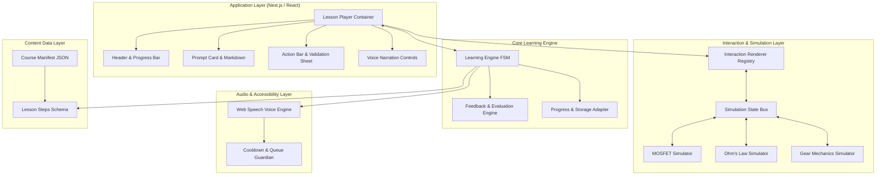

# 공학 교육 플랫폼 아키텍처 제안서 (Architecture Proposal)

> **문서 상태**: DRAFT FOR A01 REVIEW  
> **분석 주체**: REA 전담 분석 에이전트  
> **플랫폼명**: Interactive Engineering  
> **구현 대상**: 개발 에이전트 A02 (MVP 아키텍처 계약)  
> **핵심 설계 원칙**: **"엔진(Engine)과 콘텐츠(Content)의 완전한 분리"**, **"순수 물리 시뮬레이션(Pure Simulation)과 렌더러(Renderer)의 분리"**

---

## 1. 플랫폼 아키텍처 개요 및 시스템 분할

Interactive Engineering은 새로운 공학 주제나 물리 법칙이 추가될 때마다 전체 코드를 다시 작성하지 않고, **표준화된 데이터 스키마(JSON/TS)와 시뮬레이터 플러그인만 추가하면 즉시 새로운 강좌가 구동되는 범용 인터랙티브 학습 플랫폼**을 지향합니다.



---

## 2. 8대 필수 핵심 시스템 정의 및 책임

| 시스템명 | 핵심 책임 | 입력 (Input) | 출력 (Output) | 주요 인터페이스 |
|:---|:---|:---|:---|:---|
| **1. Learning Engine** | 학습 스텝 상태 관리, FSM 전이 제어, 세션 복원 | 유저 이벤트, 평가 결과 | 현재 스텝 상태, 활성 UI 플래그 | `useLearningEngine()`, `dispatch()` |
| **2. Lesson Player** | 반응형 분할 화면 레이아웃, 헤더, 진행 바, 스텝 전환 뷰 | 스텝 데이터, 캔버스 뷰 | 렌더링된 화면 DOM | `<LessonPlayer />` |
| **3. Interaction Renderer** | 인터랙션 타입 문자열을 해당 React 컴포넌트로 동적 디스패치 | `interactionType`, `config` | 슬라이더, 드래그, 스위치 UI | `<InteractionRegistry />` |
| **4. Simulation Engine** | 렌더링과 독립된 순수 물리/수학 모델 연산 | 파라미터 ($V, R, N$) | 물리적 상태 ($I, P, \omega, \text{Mesh}$) | `Simulator<TState, TInput>` |
| **5. Feedback Engine** | 현재 시뮬레이션 상태가 스텝 목표를 달성했는지 평가 | `simState`, `criteria` | `ValidationResult` (pass, reason) | `validateStep(state, rules)` |
| **6. Voice Engine** | 브라우저 TTS 발화 제어, 쿨다운, 스텝 전환 시 취소 | 음성 대사, 이벤트 키 | 한국어 오디오 발화 | `voiceEngine.speak()` |
| **7. Progress Tracking** | 로컬스토리지 기반 진행률 저장, 향후 Supabase 연동 지원 | 완료된 스텝, 소요시간 | 영속 저장된 학습 기록 | `IProgressRepository` |
| **8. Content Management** | 강좌 계층 구조 및 스텝 정의 데이터 스키마 유효성 검증 | JSON / TS 파일 | 타입 안전한 강좌 데이터 | `CourseManifest`, `Lesson` |

---

## 3. 콘텐츠 데이터 계층 구조 (Data Hierarchy)

콘텐츠는 다음 5단계 계층으로 구성됩니다.
```
Subject (분야: 반도체 / 전기전자 / 기계공학)
└── Course (강좌: Circuits, Digital Circuits, MOSFET 소자공학)
    └── Level / Unit (단원: Level 1 Circuits, Level 2 Current)
        └── Lesson (레슨: Current Loops, Short Circuits)
            └── Step (스텝: 1~5개의 개별 인터랙티브 카드)
```

### 엄밀한 TypeScript 스키마 정의
```typescript
export interface CourseManifest {
  id: string;
  slug: string;
  title: string;
  subject: "semiconductor" | "electrical" | "mechanical";
  description: string;
  levels: CourseLevel[];
}

export interface CourseLevel {
  id: string;
  levelNumber: number;
  title: string;
  descriptionBullets: string[];
  lessons: LessonMeta[];
}

export interface LessonMeta {
  id: string;
  slug: string;
  title: string;
  estimatedMinutes: number;
  totalSteps: number;
}

export interface Lesson {
  id: string;
  title: string;
  steps: LessonStep[];
}

export interface LessonStep {
  id: string;
  stepNumber: number;
  title: string;
  
  // 프롬프트 및 지문
  prompt: {
    question: string;
    details?: string;
    inlineBadges?: Record<string, { label: string; color: string; valueKey: string }>;
  };

  // 인터랙션 유형 및 설정
  interaction: {
    type: 
      | "INT-SLIDER-CONT" 
      | "INT-SLIDER-DISC" 
      | "INT-DND-MATCH" 
      | "INT-OBJ-DRAG" 
      | "INT-MULTI-VAR"
      | "INT-SC" 
      | "INT-MC";
    simulatorId: "mosfet" | "ohms-law" | "gears";
    initialInputs: Record<string, any>;
    controls: InteractionControlConfig[];
  };

  // 평가 및 검증 규칙
  validation: {
    rules: ValidationRule[];
    explanationOnSuccess: string;
    explanationOnFailure: string;
  };

  // 단계별 힌트
  hints: {
    level1: string;
    level2?: string;
    level3?: string;
  };

  // 분리된 한국어 음성 대사
  narration: {
    intro: string;
    onMilestone?: Record<string, string>;
    correct: string;
    incorrect: string;
    hint?: string;
  };
}

export interface InteractionControlConfig {
  id: string;
  label: string;
  component: "slider" | "switch" | "stepper" | "drag-palette";
  min?: number;
  max?: number;
  step?: number;
  unit?: string;
  defaultValue: any;
}

export interface ValidationRule {
  targetField: string;
  operator: "eq" | "gt" | "gte" | "lt" | "lte" | "between" | "custom";
  expectedValue: any;
  tolerance?: number;
}
```

---

## 4. 순수 물리 시뮬레이터 인터페이스 (Simulator Adapter API)

모든 물리 시뮬레이션(MOSFET, 옴의 법칙, 기어)은 React 렌더링에 직접 종속되지 않는 **순수 클래스/함수(Pure Physics Engine)**로 구현됩니다. 이를 통해 단위 테스트가 매우 용이해집니다.

```typescript
export interface SimulatorAdapter<TState, TInput> {
  id: string;
  init(initialInputs: TInput): TState;
  update(inputs: Partial<TInput>, currentState: TState): TState;
  getMilestones(prevState: TState, nextState: TState): string[]; // e.g., ["threshold_reached"]
  validate(criteria: ValidationRule[], currentState: TState): boolean;
}
```

---

## 5. 대표 3개 MVP 공학 시뮬레이션 모델 구현 사양

### 5.1. 반도체: MOSFET 원리 및 채널 형성 모델
- **입력 파라미터 (`TInput`)**:
  - `vgs`: 게이트-소스 전압 ($0.0\text{V} \sim 3.0\text{V}$, 기본 $0.0\text{V}$)
  - `vds`: 드레인-소스 전압 ($0.0\text{V} \sim 3.0\text{V}$, 기본 $1.0\text{V}$)
- **물리 상수 및 스펙**:
  - 문턱 전압 $V_{th} = 0.7\text{V}$
  - 파라미터 $k = \frac{1}{2} \mu_n C_{ox} (W/L) = 2.0\text{ mA/V}^2$
- **수학적 동작 영역 (Operating Regions)**:
  1. **차단 영역 (Cutoff)** ($V_{GS} < V_{th}$):
     $$I_D = 0\text{ mA}$$
     - 채널 전자 농도: $0$
     - 상태 플래그: `mode = "CUTOFF"`
  2. **선형/트라이오드 영역 (Triode/Linear)** ($V_{GS} \ge V_{th}$ 및 $V_{DS} < V_{GS} - V_{th}$):
     $$I_D = k \cdot \left[ 2(V_{GS} - V_{th})V_{DS} - V_{DS}^2 \right]$$
     - 채널 형성: 소스부터 드레인까지 균일한 두께의 전자 반전층 형성.
     - 상태 플래그: `mode = "TRIODE"`
  3. **포화 영역 (Saturation)** ($V_{GS} \ge V_{th}$ 및 $V_{DS} \ge V_{GS} - V_{th}$):
     $$I_D = k \cdot (V_{GS} - V_{th})^2$$
     - 핀치오프(Pinch-off) 발생: 드레인 측 채널 협착.
     - 상태 플래그: `mode = "SATURATION"`
- **마일스톤 감지**:
  - $V_{GS}$가 $0.7\text{V}$ 미만에서 $0.7\text{V}$ 이상으로 교차할 때 $\to$ `"channel_formed"` 트리거.

---

### 5.2. 전기전자: 옴의 법칙 및 전구 회로 모델 ($V = I \times R$)
- **입력 파라미터 (`TInput`)**:
  - `voltage`: 배터리 전압 ($1.0\text{V} \sim 12.0\text{V}$)
  - `resistance`: 가변 저항 ($5\Omega \sim 100\Omega$)
  - `switchClosed`: 스위치 연결 여부 (`boolean`)
- **수학적 계산**:
  - 스위치 열림: $I = 0\text{ A}, P = 0\text{ W}$
  - 스위치 닫힘:
    $$I = \frac{V}{R} \quad (\text{A})$$
    $$P = I^2 \cdot R = \frac{V^2}{R} \quad (\text{W})$$
- **시각적 상태 (`TState`)**:
  - `current`: 계산된 전류값
  - `power`: 전구 소비 전력 (전구 밝기 Glow 강도에 매핑)
  - `driftSpeed`: 도선 내 전자 점선 애니메이션 속도 ($v_d \propto I$)
  - `isOverheated`: $I > 1.5\text{A}$일 때 과전류 경고 플래그
- **마일스톤 감지**:
  - `switchClosed` 전환 $\to$ `"circuit_closed"`
  - $I \ge 1.0\text{A}$ 도달 $\to$ `"high_current"`

---

### 5.3. 기계공학: 2단 맞물림 기어 시스템 (Gear Ratio)
- **입력 파라미터 (`TInput`)**:
  - `driverTeeth` ($N_1$): 구동 기어 잇수 ($12, 18, 24, 36$)
  - `drivenTeeth` ($N_2$): 종동 기어 잇수 ($12, 18, 24, 36$)
  - `inputSpeed` ($\omega_1$): 구동축 각속도 ($1.0\text{ rad/s}$, 시계 방향)
  - `inputTorque` ($\tau_1$): 구동축 토크 ($10.0\text{ N}\cdot\text{m}$)
- **수학적 계산**:
  - 기어비:
    $$\text{Ratio} = \frac{N_2}{N_1}$$
  - 종동축 속도 (반대 방향 회전):
    $$\omega_2 = -\omega_1 \cdot \frac{N_1}{N_2} = -\frac{\omega_1}{\text{Ratio}}$$
  - 종동축 토크 (마찰 무시 시):
    $$\tau_2 = \tau_1 \cdot \frac{N_2}{N_1} = \tau_1 \cdot \text{Ratio}$$
- **시각적 상태 (`TState`)**:
  - `gear1Angle`: 누적 회전각 ($\theta_1$)
  - `gear2Angle`: 누적 회전각 ($\theta_2$)
  - `ratio`: 계산된 기어비
  - `directionReversed`: `true` (외접 기어 맞물림)
- **마일스톤 감지**:
  - $\text{Ratio} > 1.0$ (감속 및 토크 증가) $\to$ `"torque_multiplied"`
  - $\text{Ratio} < 1.0$ (증속 및 토크 감소) $\to$ `"speed_multiplied"`

---

## 6. 진행률 저장 인터페이스 (Progress Repository)

```typescript
export interface IProgressRepository {
  getLessonProgress(courseId: string, lessonId: string): Promise<LessonProgress | null>;
  saveStepCompletion(courseId: string, lessonId: string, stepIndex: number): Promise<void>;
  markLessonComplete(courseId: string, lessonId: string): Promise<void>;
  getDailyStreak(): Promise<number>;
}

// MVP: LocalStorage 구현체
export class LocalStorageProgressRepository implements IProgressRepository {
  // 브라우저 localStorage 기반 동기 저장
}

// 향후 Post-MVP: Supabase DB 구현체로 무중단 교체 가능
export class SupabaseProgressRepository implements IProgressRepository {
  // Supabase auth.users 및 progress 테이블 연동
}
```

---

## 7. A02 개발자를 위한 확장성 지침 (Extensibility Guide)

1. **새로운 레슨을 추가할 때**:
   - `content/courses/...` 폴더에 새 TS/JSON 파일만 작성하면 되며, 컴포넌트 코드(`features/learning`, `components/lesson`)를 단 한 줄도 수정할 필요가 없어야 합니다.
2. **새로운 물리 시뮬레이터를 추가할 때**:
   - `simulations/` 폴더에 `SimulatorAdapter` 인터페이스를 만족하는 새 클래스 1개(예: `HydraulicsSimulator`)를 추가하고, `InteractionRenderer`의 맵 객체에 등록만 하면 됩니다.
