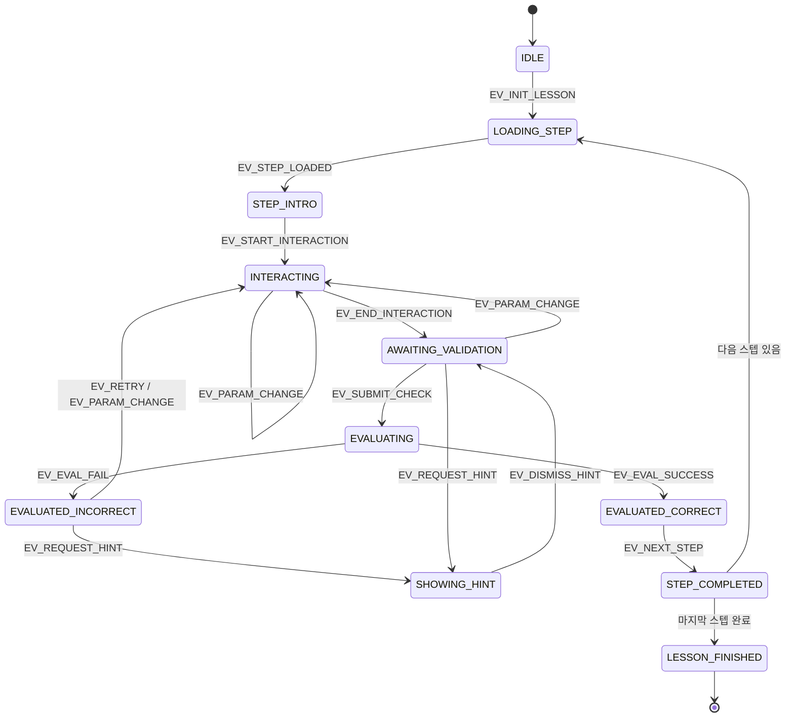

# 학습 엔진 상태 머신 및 전이 매트릭스 명세서 (Lesson State Matrix)

> **문서 상태**: DRAFT FOR A01 REVIEW  
> **분석 주체**: REA 전담 분석 에이전트  
> **대상 서비스**: [Brilliant.org](https://brilliant.org/home/)  
> **플랫폼 적용**: Interactive Engineering MVP (A02 개발 계약)  
> **개발 목적**: 개발자 A02가 `XState`, `useReducer`, 또는 순수 TypeScript FSM 클래스로 직접 구현할 수 있는 엄밀한 상태 전이 계약 제공.

---

## 1. 개요 및 상태 머신 아키텍처

Interactive Engineering의 `LearningEngine`은 복잡한 학습자 상호작용, 캔버스 시뮬레이션 렌더링, Web Speech API 음성 내레이션, 로컬 저장소 동기화를 단일 신뢰 원천(Single Source of Truth)으로 관리하는 **결정론적 유한 상태 기계(Deterministic Finite State Machine)**로 동작합니다.



---

## 2. 상태 정의 (State Catalog)

| 상태 키 (State Key) | 명칭 | 화면 및 시스템 의미 |
|:---|:---|:---|
| `IDLE` | 대기 상태 | 레슨 데이터가 아직 로드되지 않은 초기 유휴 상태. |
| `LOADING_STEP` | 스텝 로딩 | 특정 스텝의 메타데이터, 시뮬레이터 파라미터, 음성 대사를 파싱 및 초기화 중인 상태. |
| `STEP_INTRO` | 질문 도입 | 스텝 진입 직후 질문과 시뮬레이터가 렌더링되고, 오디오 인트로 대사가 재생되는 상태. 조작 대기. |
| `INTERACTING` | 조작 진행 중 | 학습자가 슬라이더를 드래그하거나 회로 스위치를 토글하는 실시간 물리 입력 상태 (60fps 루프). |
| `AWAITING_VALIDATION` | 검증 대기 | 사용자가 조작을 멈추고 파라미터가 변경되어, "Check (확인)" 버튼이 활성화된 상태. |
| `EVALUATING` | 채점 평가 중 | "Check" 클릭 직후 `ValidationEngine`이 목표 도달 여부를 수학적으로 판정 중인 비동기 상태 (100~200ms). |
| `EVALUATED_CORRECT` | 정답 판정 | 목표 조건을 충족함. 승리 마이크로 애니메이션, 녹색 하단 바, 해설 노출, "Continue" 버튼 활성. |
| `EVALUATED_INCORRECT` | 오답 판정 | 목표 미충족. 캔버스 셰이크, 적색/앰버 피드백 시트 노출, 오류 원인 진단, "Try Again" 활성. |
| `SHOWING_HINT` | 힌트 노출 | 학습자의 요청으로 다단계 힌트 드로어가 열려 스캐폴딩 팁과 음성 가이드가 제공되는 상태. |
| `STEP_COMPLETED` | 스텝 완료 처리 | 현재 스텝의 성취 결과를 세션에 저장하고 다음 스텝으로의 전환 애니메이션을 준비하는 상태. |
| `LESSON_FINISHED` | 레슨 전체 수료 | 레슨의 모든 스텝이 완료되어 최종 성취 요약, 연속 학습(Streak) 배지, 다음 레슨 추천 모달이 열린 상태. |
| `PAUSED_BACKGROUND` | 일시 중지 | 브라우저 탭이 백그라운드로 전환되거나 사용자가 오디오를 일시 중지한 상태. |

---

## 3. 이벤트 정의 (Event Catalog)

| 이벤트 키 (Event Key) | 발생 주체 | 전달 페이로드 (Payload) | 설명 |
|:---|:---|:---|:---|
| `EV_INIT_LESSON` | 라우터/플레이어 | `{ lessonId: string, startStep?: number }` | 레슨 진입 및 세션 초기화 |
| `EV_STEP_LOADED` | 데이터 로더 | `{ stepIndex: number, stepData: LessonStep }` | 스텝 데이터 파싱 및 시뮬레이터 로드 완료 |
| `EV_START_INTERACTION` | 사용자 터치 | `{ inputId: string, startVal: any }` | 슬라이더 썸 터치, 기어 드래그 개시 |
| `EV_PARAM_CHANGE` | 시뮬레이터 입력 | `{ inputId: string, currentVal: any }` | 실시간 파라미터 변위 ($V, R, \theta$) |
| `EV_END_INTERACTION` | 사용자 터치 | `{ inputId: string, finalVal: any }` | 터치 릴리즈, 드래그 종료 |
| `EV_SUBMIT_CHECK` | 사용자 클릭 | `void` | "Check (확인)" 버튼 클릭 |
| `EV_EVAL_SUCCESS` | ValidationEngine | `{ score: number, explanation: string }` | 물리 목표 달성 확인 |
| `EV_EVAL_FAIL` | ValidationEngine | `{ reason: string, hintIndex: number }` | 물리 목표 미달성 및 실패 사유 |
| `EV_REQUEST_HINT` | 사용자 클릭 | `void` | 💡 힌트 버튼 클릭 |
| `EV_DISMISS_HINT` | 사용자 클릭 | `void` | 힌트 드로어 닫기 |
| `EV_RETRY` | 사용자 클릭 | `void` | "Try Again (다시 시도)" 클릭 |
| `EV_NEXT_STEP` | 사용자 클릭 | `void` | "Continue (계속하기)" 클릭 |
| `EV_PREV_STEP` | 사용자 클릭 | `{ targetStep: number }` | 상단 스텝 도트 클릭으로 이전 스텝 복귀 |
| `EV_VOICE_TOGGLE` | 사용자 클릭 | `{ enabled: boolean }` | 음소거 / 음성 켜기 토글 |

---

## 4. 정밀 상태 전이 매트릭스 (Complete State Transition Table)

| 현재 상태 (Current State) | 발생 이벤트 (Event) | 가드 조건 (Guard) | 다음 상태 (Next State) | 상태 데이터 변경 (State Mutation) | UI 사이드 이펙트 | 음성 트리거 (Voice Trigger) |
|:---|:---|:---|:---|:---|:---|:---|
| **IDLE** | `EV_INIT_LESSON` | 레슨 데이터 존재 | `LOADING_STEP` | `lessonId = payload.lessonId` | 로딩 스피너 표시 | 없음 |
| **LOADING_STEP** | `EV_STEP_LOADED` | 스텝 검증 성공 | `STEP_INTRO` | `step = payload.stepIndex` | 프롬프트 카드 렌더링, 캔버스 초기화 | `EV_VOICE_INTRO` |
| **STEP_INTRO** | `EV_START_INTERACTION`| 없음 | `INTERACTING` | `isTouched = true` | 조작 하이라이트 활성화 | 없음 (초기 음성 유지) |
| **INTERACTING** | `EV_PARAM_CHANGE` | 유효 범위 내 | `INTERACTING` | `simState = update(val)` | 캔버스 60fps 재렌더, 인라인 텍스트 갱신 | `EV_VOICE_INTERACTION` (쿨다운 검사) |
| **INTERACTING** | `EV_END_INTERACTION` | 초기값과 다름 | `AWAITING_VALIDATION` | `dirty = true` | "Check" 버튼 에메랄드 활성화 & 펄스 | 없음 |
| **AWAITING_VALIDATION**| `EV_PARAM_CHANGE` | 없음 | `INTERACTING` | `simState = update(val)` | 실시간 캔버스 재반영 | 없음 |
| **AWAITING_VALIDATION**| `EV_SUBMIT_CHECK` | Check 활성화 상태 | `EVALUATING` | `attemptCount++` | Check 버튼 로딩 스피너 | 없음 |
| **EVALUATING** | `EV_EVAL_SUCCESS` | 목표 조건 부합 | `EVALUATED_CORRECT` | `isPassed = true` | 체크마크 바운스, 녹색 피드백 시트 노출 | `EV_VOICE_CORRECT` |
| **EVALUATING** | `EV_EVAL_FAIL` | 목표 미달 | `EVALUATED_INCORRECT`| `failReason = payload` | 캔버스 6px 셰이크, 적색 시트, Try Again 활성 | `EV_VOICE_INCORRECT` |
| **EVALUATED_INCORRECT**| `EV_RETRY` | 없음 | `AWAITING_VALIDATION` | `status = "retry"` | 오류 시트 닫힘, 캔버스 상태 유지 | 없음 |
| **EVALUATED_INCORRECT**| `EV_PARAM_CHANGE` | 사용자가 재조작 | `INTERACTING` | `simState = update(val)` | 오류 시트 접힘, 즉시 재조작 모드 | 없음 |
| **AWAITING_VALIDATION**| `EV_REQUEST_HINT` | 힌트 데이터 있음 | `SHOWING_HINT` | `hintLevel++` | 힌트 드로어 슬라이드 업 | `EV_VOICE_HINT` |
| **EVALUATED_INCORRECT**| `EV_REQUEST_HINT` | 힌트 데이터 있음 | `SHOWING_HINT` | `hintLevel++` | 힌트 드로어 슬라이드 업 | `EV_VOICE_HINT` |
| **SHOWING_HINT** | `EV_DISMISS_HINT` | 없음 | `AWAITING_VALIDATION` | 없음 | 힌트 드로어 닫힘 | 발화 중단 (`cancel()`) |
| **EVALUATED_CORRECT** | `EV_NEXT_STEP` | `step < totalSteps - 1`| `STEP_COMPLETED` | `history.push(currentStep)`| 슬라이드 아웃 애니메이션 | 발화 즉시 취소 |
| **EVALUATED_CORRECT** | `EV_NEXT_STEP` | `step === totalSteps - 1`| `LESSON_FINISHED` | `lessonCompleted = true` | 리워드/스트릭 모달 팝업, 축하 파티클 | `EV_VOICE_EXPLANATION` |
| **STEP_COMPLETED** | 자동 전이 | 다음 스텝 준비 완료 | `LOADING_STEP` | `stepIndex++` | 다음 스텝 슬라이드 인 | 없음 |
| **ANY_STATE** | `EV_PREV_STEP` | `targetStep < currentStep`| `STEP_INTRO` | `step = targetStep, sandbox=true`| 이전 스텝 샌드박스 모드 로드 | 발화 취소 |

---

## 5. 세션 스냅샷 및 복원 알고리즘 (Session Restoration)

학습 도중 브라우저가 예기치 않게 새로고침되거나 닫혔을 때, 학습 흐름을 완벽하게 재구성하는 로직입니다.

```typescript
interface SessionSnapshot {
  courseId: string;
  lessonId: string;
  currentStepIndex: number;
  completedStepIndices: number[];
  simulatorInputs: Record<number, Record<string, any>>; // 스텝별 마지막 입력값
  lastUpdated: number;
}

// 1. 상태 저장 트리거: AWAITING_VALIDATION, EVALUATED_CORRECT 전이 시
function persistSnapshot(state: LearningEngineState): void {
  const snapshot: SessionSnapshot = {
    courseId: state.courseId,
    lessonId: state.lessonId,
    currentStepIndex: state.currentStepIndex,
    completedStepIndices: state.completedStepIndices,
    simulatorInputs: state.savedInputs,
    lastUpdated: Date.now()
  };
  localStorage.setItem(`ie_session_${state.courseId}_${state.lessonId}`, JSON.stringify(snapshot));
}

// 2. 상태 복원 로직: EV_INIT_LESSON 처리 시
function restoreSnapshot(courseId: string, lessonId: string): Partial<LearningEngineState> | null {
  const raw = localStorage.getItem(`ie_session_${courseId}_${lessonId}`);
  if (!raw) return null;
  try {
    const data: SessionSnapshot = JSON.parse(raw);
    // 24시간 이내의 세션만 유효한 것으로 인정
    if (Date.now() - data.lastUpdated > 24 * 60 * 60 * 1000) return null;
    return {
      currentStepIndex: data.currentStepIndex,
      completedStepIndices: data.completedStepIndices,
      savedInputs: data.simulatorInputs
    };
  } catch {
    return null;
  }
}
```

---

## 6. A02 개발자를 위한 구현 지침

1. **상태 머신 라이브러리 선택**:
   - 외부 종속성을 최소화하기 위해 **React 18의 `useReducer`와 순수 TypeScript 타입 유니온(Discriminated Unions)**으로 상태 머신을 구현하는 것을 강력히 권장합니다.
2. **사이드 이펙트의 순수성 보장**:
   - 상태 머신의 리듀서는 순수 함수(Pure Function)로 유지하고, 오디오 발화(`speechSynthesis`)나 `localStorage` 쓰기는 `useEffect` 또는 미들웨어 계층에서 상태 변화를 감지하여 수행해야 합니다.
3. **불변성(Immutability)**:
   - 시뮬레이터 상태 변경 시 이전 상태 객체를 직접 변소(Mutate)하지 말고, 항상 새로운 객체 얕은 복사본(`{ ...state, voltage: newVal }`)을 반환하여 리렌더링 버그를 방지하십시오.
