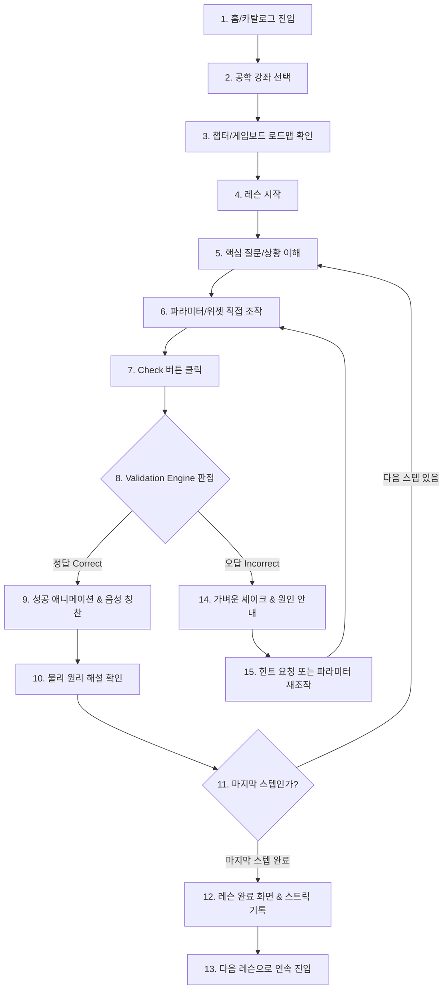

# 전체 사용자 여정 맵 (End-to-End User Journey Map)

> **문서 상태**: DRAFT FOR A01 REVIEW  
> **분석 주체**: REA 전담 분석 에이전트  
> **대상 서비스**: [Brilliant.org](https://brilliant.org/home/)  
> **플랫폼 적용**: Interactive Engineering MVP (A02 개발 계약)  
> **증거 상태**: `OBSERVED` (정상 브라우징 및 GraphQL 세션 관찰), `PROPOSED` (공학 플랫폼 독립 설계)

---

## 1. 개요 및 설계 철학

Interactive Engineering의 사용자 여정은 **"마찰 없는 즉각적 조작(Zero-Friction Tactile Play)"**을 핵심 가치로 삼습니다.  
학습자가 가입 절차나 긴 동영상 강의에 가로막히지 않고, 접속 후 30초 이내에 첫 번째 인터랙티브 물리 위젯을 직접 만지고 즉각적인 피드백을 경험할 수 있도록 구성합니다.

---

## 2. 핵심 표준 여정 (Primary Happy Path Flow)

---

## 3. 단계별 상세 여정 명세 (Primary Flow Stages)

### Stage 1: 홈 진입 및 강좌 탐색 (Entry & Discovery)
- **진입 조건**: 브라우저에서 루트 URL(`/`) 접속.
- **UI 상태**: 비로그인 게스트 상태, 추천 강좌 카드 그리드(반도체, 회로, 기계) 및 직관적 인터랙티브 히어로 데모 노출.
- **사용자 행동**: 마우스 호버로 강좌 개요 확인 후 관심 강좌(예: "전기전자 및 회로") 클릭.
- **상태 전이**: 라우터 `/courses/circuits`로 이동.
- **종료 조건**: 강좌 상세 로드맵 페이지 렌더링 완료.
- **Voice 훅**: 없음 (사용자 자발적 탐색 단계).

---

### Stage 2: 강좌 로드맵 및 레슨 선택 (Gameboard Navigation)
- **진입 조건**: 특정 강좌 페이지 진입.
- **UI 상태**:
  - 강좌 헤더: 강좌 타이틀, 핵심 개념(Current, Voltage, Resistance), 전체 진행률(0%).
  - 게임보드 레벨: Level 1 (Circuits) 활성화, 첫 번째 노드 "Current Loops" 활성화(Pulse Ring 효과).
- **사용자 행동**: 활성화된 첫 번째 레슨 노드 클릭.
- **상태 전이**: `LessonPlayer` 로딩, URL `/courses/circuits/circuits/current-loops` 전환.
- **종료 조건**: 레슨 런타임 환경 구성 및 스텝 1 로드.

---

### Stage 3: 레슨 도입 및 질문 이해 (Context Priming)
- **진입 조건**: `LessonPlayer` 마운트 완료.
- **UI 상태**:
  - 상단 바: X 닫기 버튼, 레슨 타이틀, 스텝 인디케이터(총 4개 중 1번째 도트 활성), 음성 스피커 아이콘.
  - 좌측 프롬프트 카드: 도발적인 1~2문장의 핵심 질문 (예: "전구가 켜지려면 배터리 양극 사이에 닫힌 루프가 필요합니다. 스위치를 닫아 전구를 켜보세요").
  - 우측 인터랙티브 캔버스: 전원(배터리), 단선된 스위치, 꺼진 전구가 배치된 2D 벡터 회로도.
  - 하단 액션 바: "Check" 버튼이 비활성화(disabled) 상태로 대기.
- **Voice 훅**: `EV_VOICE_INTRO` $\to$ 친근한 튜터 어조로 질문 낭독: "전구에 불을 켜려면 어떻게 연결해야 할까요? 스위치를 눌러보세요."

---

### Stage 4: 직접 조작 및 가설 검증 (Direct Manipulation)
- **진입 조건**: 사용자가 마우스 또는 터치로 캔버스 내 스위치를 클릭/드래그.
- **UI 상태**:
  - 스위치가 닫힘(Closed) 위치로 부드럽게 스프링 회전.
  - 시뮬레이터가 닫힌 회로를 감지하고 도선 내부의 전자(Cyan 도트)가 60fps로 흐르기 시작.
  - 전구 필라멘트가 밝은 노란색(Yellow Glow, CSS Drop-shadow)으로 발광.
  - 하단 액션 바의 "Check" 버튼이 활성화(Enabled, 진한 에메랄드/브랜드 컬러로 강조 및 펄스).
- **Voice 훅**: `EV_VOICE_INTERACTION_FEEDBACK` (선택적 마일스톤) $\to$ 닫힌 루프 형성 시 "스위치가 연결되었습니다!" (과도한 발화 방지를 위해 디바운스 적용).

---

### Stage 5: 결과 제출 및 평가 (Verification & Feedback)
- **진입 조건**: 사용자가 하단 "Check" 버튼 클릭.
- **UI 상태**:
  - `FeedbackEngine`이 현재 시뮬레이션 상태(`switchClosed === true`, `current > 0`)를 목표 조건과 비교.
  - **정답 판정 시**:
    - 하단 액션 바가 녹색 배경 피드백 시트로 전환.
    - 체크마크 아이콘 바운스 애니메이션.
    - 정답 해설 텍스트 노출: "훌륭합니다! 전류는 배터리의 양극에서 음극으로 닫힌 루프를 따라 계속 순환합니다."
    - "Check" 버튼이 "계속하기 (Continue)" 버튼으로 변환.
- **Voice 훅**: `EV_VOICE_CORRECT` $\to$ 경쾌한 톤: "정답입니다! 전류가 닫힌 루프를 통해 흐르고 있습니다."

---

### Stage 6: 해설 확인 및 다음 스텝 이동 (Progression)
- **진입 조건**: "Continue" 버튼 클릭 또는 키보드 Enter 입력.
- **UI 상태**:
  - 캔버스와 프롬프트 카드가 좌측으로 슬라이드 아웃(`translateX(-24px)`, `opacity: 0`).
  - 스텝 인디케이터 2번째 도트로 활성화 이동.
  - 스텝 2의 새로운 문제(예: "이번엔 스위치 2개로 전구 2개를 독립 제어해보세요")가 우측에서 슬라이드 인(`translateX(24px) $\to$ 0`).
  - 이전 발화 즉시 취소(`speechSynthesis.cancel()`).
- **종료 조건**: 스텝 2의 조작 대기 상태로 전이.

---

### Stage 7: 레슨 완료 및 리워드 (Completion & Persistence)
- **진입 조건**: 레슨의 마지막 스텝(예: 스텝 4)에서 "Check" 완료 및 "Finish" 클릭.
- **UI 상태**:
  - 전체 화면 완료 모달 렌더링.
  - 축하 팡파레 효과 (경량 CSS Confetti / Ring Pulse).
  - 스트릭 배지: "🔥 연속 학습 1일 달성!".
  - 학습 통계: "완료한 인터랙션: 4개", "소요 시간: 3분 20초".
  - 메인 액션 버튼: "다음 레슨으로 이동: Short Circuits".
  - 서브 액션 링크: "강좌 로드맵으로 돌아가기".
- **데이터 영속화**:
  - `LocalStorage`에 `{ courseId: "circuits", lessonId: "current-loops", completed: true, timestamp: Date.now() }` 저장.
- **Voice 훅**: `EV_VOICE_EXPLANATION` $\to$ "수고하셨습니다! 첫 번째 회로 레슨을 완벽하게 마쳤습니다."

---

## 4. 예외 및 분기 여정 (Secondary & Edge Flows)

### Flow E1: 오답 발생 및 재시도 (Failure Loop & Retry)
- **발생 시점**: 사용자가 목표와 다른 조건(예: 스위치를 잘못된 단자에 연결하여 쇼트 유발)에서 "Check" 클릭.
- **시스템 반응**:
  - 캔버스가 부드럽게 좌우로 진동 (Shake: `±6px`, 350ms).
  - 하단 액션 바가 소프트 레드/앰버 테마로 전환.
  - 피드백 문구: "전구에 불이 켜지지 않았습니다. 전선이 올바른 단자에 닿아 있는지 확인해보세요."
  - 버튼이 "다시 시도 (Try Again)"로 변경.
  - **중요 불변성**: 사용자가 배치해 둔 캔버스 오브젝트를 강제로 초기화하지 않음. 학습자가 자신의 오류를 관찰할 수 있도록 유지.
- **사용자 행동**: "Try Again" 클릭 $	o$ 오류 수정 $	o$ 재검증.
- **Voice 훅**: `EV_VOICE_INCORRECT` $\to$ 차분하고 온화한 톤: "아직 전구가 켜지지 않았네요. 연결 상태를 다시 확인해볼까요?"

---

### Flow E2: 점진적 힌트 요청 (Progressive Hint Disclosure)
- **발생 시점**: 문제를 어떻게 풀어야 할지 몰라 💡 힌트 버튼 클릭.
- **1차 클릭 (Level 1 Hint)**:
  - 캔버스 하단에서 가벼운 팁 툴팁 확장: "전류는 끊어진 도선을 건널 수 없습니다. 스위치를 닫아보세요."
- **2차 클릭 (Level 2 Hint)**:
  - 핵심 조작 컴포넌트(스위치 1번) 주변에 부드러운 펄스 하이라이트 테두리 점멸.
- **3차 클릭 (Level 3 Hint)**:
  - 정답에 준하는 논리적 연결 방법 제공.
- **Voice 훅**: `EV_VOICE_HINT` $\to$ 해당 힌트 레벨에 맞는 팁 낭독.

---

### Flow E3: 학습 중도 이탈 및 세션 복원 (Abandon & Resume)
- **시나리오**: 스텝 3 조작 도중 브라우저 탭을 닫거나 새로고침 발생.
- **복원 메커니즘**:
  1. `LessonPlayer` 마운트 시 `LocalStorage`에서 활성 세션 키(`active_session_circuits_current-loops`) 조회.
  2. 저장된 스텝 번호(Step 3)와 마지막 성공했던 파라미터 값 복원.
  3. 스텝 1부터 다시 풀지 않고, 중단했던 스텝 3의 프롬프트와 캔버스를 즉시 재구성.
  4. 상단 알림 배너 1.5초 표시: "이전 학습 위치에서 이어합니다."

---

### Flow E4: 이전 단계로 돌아가기 (Previous Step Navigation)
- **시나리오**: 이미 푼 이전 스텝의 원리를 다시 확인하고 싶을 때 상단 스텝 바의 이전 도트 클릭.
- **시스템 반응**:
  - 현재 진행 상태를 임시 캐시에 저장.
  - 이전 스텝의 캔버스는 **"완료된 샌드박스 상태(Solved Sandbox Mode)"**로 렌더링.
  - 자유롭게 파라미터를 다시 조작해볼 수 있으며, 채점 버튼 대신 "현재 스텝으로 복귀" 버튼 노출.

---

## 5. 학습자 여정 상태 전이 매트릭스 요약

| 여정 단계 | 진입 트리거 | 화면 상태 | 조작 가능 여부 | Voice 이벤트 | 종료/전이 트리거 |
|:---|:---|:---|:---|:---|:---|
| **1. 탐색** | URL 접속 | 홈/카탈로그 카드 | 카드 클릭 | 없음 | 강좌 카드 클릭 |
| **2. 로드맵** | 강좌 선택 | 게임보드 레벨 맵 | 레슨 노드 클릭 | 없음 | 노드 클릭 |
| **3. 도입** | 레슨 진입 | 스텝 인트로 & 캔버스 | 관찰 | `INTRO` | 렌더 완료 후 대기 |
| **4. 조작** | 사용자 제스처 | 실시간 60fps 렌더 | 슬라이더/스위치 | `INTERACTION` | 파라미터 변경 |
| **5. 검증** | Check 클릭 | 평가 대기 (Loading) | 입력 일시 잠금 | 없음 | 엔진 평가 완료 |
| **6. 성공** | 정답 판정 | 에메랄드 피드백 시트 | Continue 클릭 | `CORRECT` | Continue 클릭 |
| **7. 실패** | 오답 판정 | 레드 피드백 시트 | Try Again 클릭 | `INCORRECT` | Try Again 클릭 |
| **8. 힌트** | 💡 클릭 | 힌트 드로어 확장 | 힌트 읽기 | `HINT` | 드로어 닫기 |
| **9. 완료** | 마지막 스텝 통과 | 리워드/스트릭 모달 | 다음 강좌/홈 | `EXPLANATION` | 다음 레슨 클릭 |

---

## 6. A02 개발자를 위한 구현 체크포인트

1. **URL 라우팅 구조**:
   - 강좌 로드맵: `/courses/:courseId`
   - 레슨 플레이어: `/courses/:courseId/:levelId/:lessonId?step=:stepIndex`
2. **세션 복원 키 스키마**:
   - `interactive_eng_progress_{courseId}_{lessonId} = { currentStep: number, completedSteps: number[], lastUpdated: number }`
3. **포커스 및 키보드 접근성**:
   - 스텝 전환 시 포커스는 자동으로 새 프롬프트 카드로 이동.
   - Enter 키는 "Check" 및 "Continue"의 글로벌 단축키로 바인딩.
   - Space 키는 활성화된 스위치/버튼의 토글 단축키.
